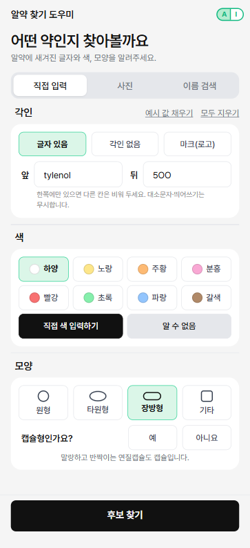
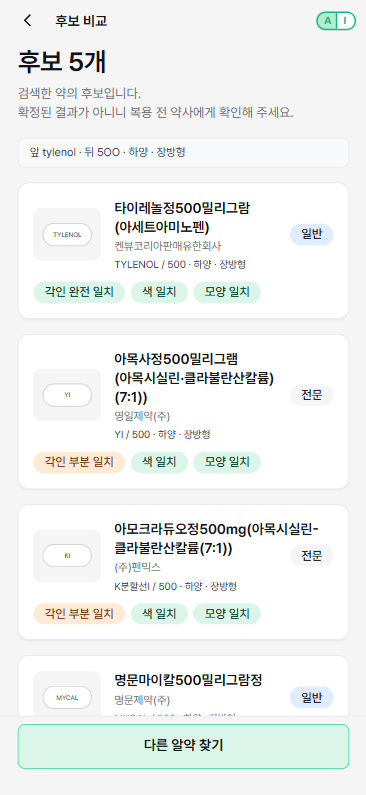
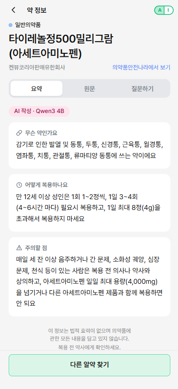
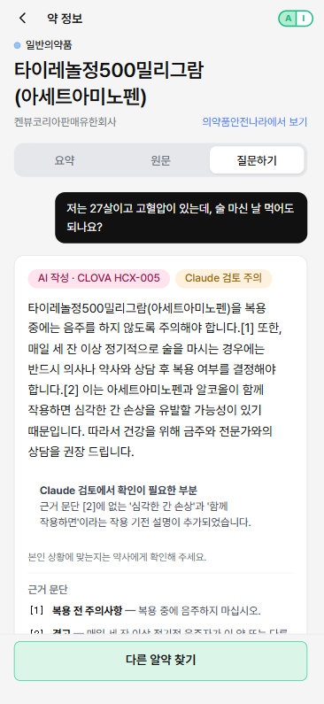
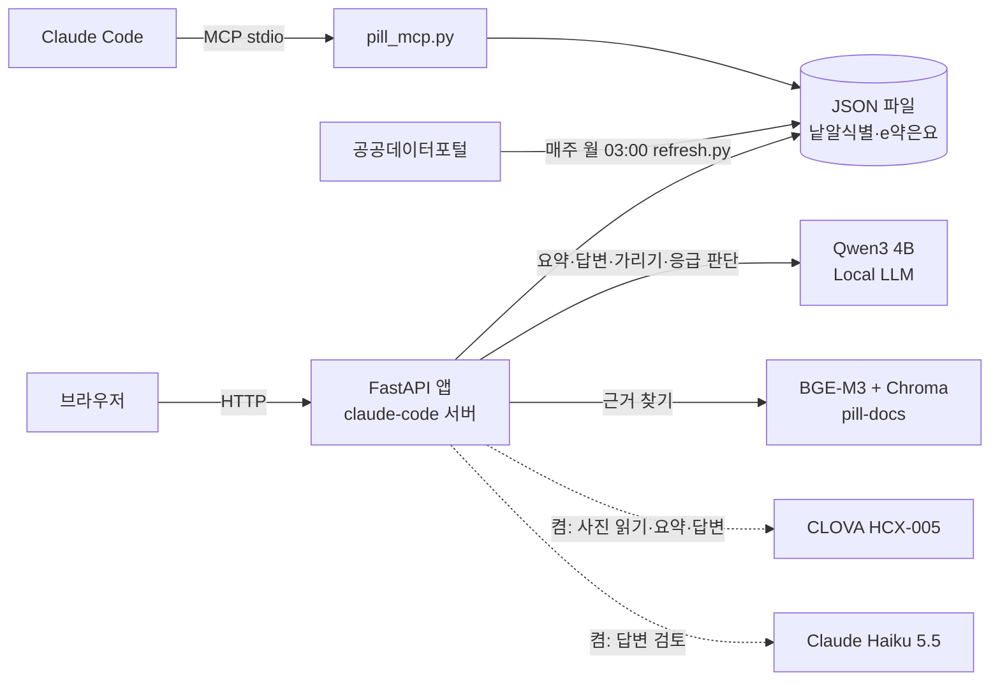

# 알약 찾기 도우미

> 약통 밖으로 나온 알약 하나, 무슨 약인지 모를 때 — 각인·색·모양으로 후보를 찾고, 식약처 공식 원문을 근거로 쉬운 말 요약과 질문 답변을 보여 주는 웹앱

- **데모 웹사이트**: https://leebomin.github.io/pill-finder/demo/
- 대상: 혼자 사는 대학생·사회초년생 · 일반의약품만 정보·질문 제공(처방약은 안내와 링크만)

> ⚠️ 의료 조언이 아닙니다. 화면의 후보는 확정 결과가 아니며, 복용 전 약사에게 확인하세요.

## 시연 영상

(업로드 예정)

실제 서버에서 탁센 연질캡슐 사진 한 장으로 시작해, 후보 찾기 → 공식 정보 확인 → 질문 답변 → 응급 안내까지 한 번에 보여 줍니다. (약 1분 20초, 소리 없음)

| 장면 | 볼 점 |
|---|---|
| **사진으로 각인 읽기** — 알약 앞·뒤 사진을 올리고 점선 상자를 알약에 맞춘 뒤 읽기 | 사진은 위치 정보(EXIF)를 지우고 자른 부분만 CLOVA로 보내며, 서버에 저장하지 않음 |
| **읽은 값 확인** — 각인·색·모양이 입력칸에 채워지고, 사람이 알약과 비교해 고친 뒤 후보 찾기 | 모델이 읽은 값을 그대로 믿지 않고 사람이 확인. 연질캡슐도 캡슐로 고름 |
| **후보 비교** — 점수순 후보와 일치 항목 배지(각인·색·모양·캡슐), 자료 기준 시점 | 점수 계산은 모델이 아니라 코드. 식약처 낱알식별 25,502건 |
| **약 정보** — 쉬운 말 요약(AI 작성 표시)과 e약은요 공식 원문을 탭으로 나눠 보여 줌 | 모델 설명과 공식 원문을 섞지 않음 |
| **질문하기** — "고혈압이 있는데 먹어도 되나요?" → 개인정보를 [가림]으로 바꾼 문장을 확인 → 근거 찾기·답변·검사·검토 단계가 차례로 진행 | 외부(CLOVA·Claude)에는 가린 문장만 전송. 근거 찾기는 서버 안에서 원래 질문으로 해서 고혈압 주의 문단을 찾음. 답변 문장마다 근거 번호 |
| **응급 안내** — "약을 한꺼번에 많이 먹었어요" → 답변보다 먼저 119 안내 | 표현 목록 + Local LLM 판단으로 응급 질문 20/20 감지 |

> 영상 속 답변은 그 시점의 공식 자료와 모델 출력이며 의료 조언이 아닙니다.

## 화면

| 1. 약 찾기 | 2. 후보 비교 | 3. 약 정보 | 3. 질문하기 |
|---|---|---|---|
|  |  |  |  |
| 각인 앞·뒤, 색, 모양, 캡슐 (사진으로 각인 읽기도 가능) | 점수순 후보 5개, 일치 항목 배지, 자료 기준 시점 | 요약(무슨 약·복용법·주의) / 원문 / 질문하기 | 개인정보 가리기 확인 → 단계 표시 → 답변 + 근거 문단 + 검토 결과 |

## 주요 기능

1. **후보 찾기** — 식약처 낱알식별 25,502건에서 각인·색·모양·캡슐 점수로 상위 5개. 대소문자·공백·하이픈 무시, `0/O`·`1/I/l`·`5/S`·`8/B`는 같은 글자로 봄(`tylenol` / `5OO` → 타이레놀정500 1위)
2. **사진으로 각인 읽기** (선택) — 사진을 잘라 위치 정보(EXIF)를 지운 뒤 CLOVA HCX-005가 각인·색·모양을 읽어 입력칸을 채움. 사진은 저장하지 않음
3. **이름 검색** — 낱알 자료에 없는 물약 등 일반의약품도 이름으로 찾음
4. **공식 원문과 쉬운 말 요약** — e약은요 원문을 항목별로 보여 주고, 요약은 따로 탭에 "AI 작성" 표시. 원문에 없는 숫자가 요약에 있으면 경고
5. **근거 기반 질문** — 그 약의 원문 문단만 RAG로 찾아 답하고, 근거가 없으면 "공식 자료에 해당 내용이 없습니다"
6. **MCP 도구 4개** — 같은 기능을 Claude Code에서 도구로 사용(`search_pills`, `find_drug_by_name`, `get_official_info`, `find_evidence`)

## 구성



| 단계 | 누가 | 하는 일 |
|---|---|---|
| 후보 점수·규칙 검사·비용 계산 | 코드 | 각인 완전 일치 40 / 부분 20, 색·모양 각 15, 캡슐 10 |
| 요약·답변 | CLOVA HCX-005 (끄면 Qwen3 4B) | 근거 문단 번호를 붙여 작성 |
| 개인정보 가리기 | Qwen3 4B + 코드 규칙 | 나이·임신·연락처·학교·직장·병명·사는 곳을 [가림]으로 |
| 근거 찾기 | BGE-M3 + Chroma | 질문한 약의 문단 중 최대 5개 |
| 답변 검토 | Claude Haiku 5.5 | 근거 밖 문장·단정 표현에 주의 표시 |

### 질문 하나가 처리되는 순서
1. **응급 표현**("삼켰", "한꺼번에", "여러 알 먹었" 등)이면 답을 기다리지 않고 **119 안내를 먼저** 표시. 목록에 안 걸린 질문은 Qwen이 한 번 더 판단(약 0.4초)
2. 외부 전송 단계가 켜져 있으면 **개인정보 가리기** → 사용자가 가린 문장을 확인해야 전송(서버도 가리지 않은 질문은 거부). 원래 질문은 근거 찾기·응급 판단(서버 안)에만 쓰여, "고혈압"이 가려져도 고혈압 주의 문단을 찾음
3. **근거 찾기** → **답변 작성** → **코드 규칙 검사**(단정 표현, 근거 번호 없는 문장) → **Claude 검토**
4. 진행 단계는 SSE로 화면에 실시간 표시. 질문은 POST 본문으로만 보내 주소·로그에 남지 않음

## 안전장치

- 키는 서버 `.env`(권한 600)에만. 화면·로그·오류 문구에 키와 요청 주소를 남기지 않음
- 질문·사진은 저장하지 않음. 하루 한도: 질문 50회, 사진 읽기 50회(앱 전체, 서버를 다시 켜도 이어서 셈)
- 처방약은 정보·질문 없이 의약품안전나라 링크만
- 공공 API·Local LLM·검색 서버가 실패하면 정해진 안내 문구. 자료 갱신이 실패하면 기존 자료를 유지하고 "마지막 갱신 실패" 표시
- 사용자 입력과 서버에서 받은 글자는 모두 이스케이프해서 화면에 넣음

## 비용 스위치

| 스위치 | 켬 | 끔 (무료 모드) |
|---|---|---|
| `PHOTO_READ` | 사진 탭 (한 장 약 2.3원) | 사진 탭 없음 |
| `CLOVA_TEXT` | 요약·답변을 CLOVA가 작성 | Qwen3 4B가 작성 |
| `CLAUDE_REVIEW` | Haiku 5.5 검토 (1회 약 0.3원) | "검토하지 않은 답변" + 코드 규칙 검사 |
| `CLOVA_MONTHLY_CAP_KRW` | 기본 5000원. 넘으면 그 달은 무료 모드로 바뀌고 첫 화면에 안내 | — |

모두 꺼도(무료 모드) 찾기·요약·질문이 끝까지 동작하고, 공공 API 외 외부 호출은 0회입니다.

## 검증 결과

완료 기준 19개 중 17개 확인 ([점검표](docs/completion-checklist.md)). 아래는 **규칙을 고치기 전에 써 둔 처음 보는 질문** 기준입니다.

| 항목 | 결과 |
|---|---|
| 개인정보 질문을 모두 가림 | 9/10 (괄호 안 나이 "(29)" 하나 남음), 확인 전 외부 전송 0/10 |
| 응급 질문에 119 먼저 | 20/20 (표현 목록만으로는 3/20 → 목록 + Qwen) |
| 답변에 근거 문단 또는 "공식 자료에 없음" | 20/20 |
| 근거 밖 문장에 검토 주의 표시 | 5/5 |
| 무료 모드 답변 시간 | 중앙 5.3초 |
| 같은 약 요약 다시 열기 | 0.001초 (저장된 요약) |

측정 스크립트와 질문·결과는 [`measure/`](measure/)에 있습니다.

## 빠른 시작

```bash
cd app
python -m venv .venv && .venv/bin/pip install -r requirements.txt
cp .env.example .env          # 키와 수업 서버 주소를 채움 (스위치는 off = 무료 모드)
.venv/bin/python refresh.py   # 공공데이터 받기, 약 40초 (data/는 저장소에 넣지 않음)
.venv/bin/uvicorn app:app --host 0.0.0.0 --port 8000
# 자가 검사
for f in test_search ai clova photo; do .venv/bin/python $f.py; done
```

- 필요한 것: 공공데이터포털 키(낱알식별 `MdcinGrnIdntfcInfoService03`, e약은요 `DrbEasyDrugInfoService`), Local LLM(Qwen3 4B, BGE-M3, Ollama), Chroma 서버. CLOVA·Anthropic 키는 스위치를 켤 때만
- 상시 실행: [`deploy/pill-finder.service`](deploy/pill-finder.service)(systemd), 주 1회 갱신: [`deploy/crontab.txt`](deploy/crontab.txt)
- MCP 등록: `claude mcp add pill-finder -s local -- <python 경로> <app 경로>/pill_mcp.py`
- 설정 자세히: [`app/README.md`](app/README.md)

## 폴더

| 폴더 | 내용 |
|---|---|
| `app/` | 실제 앱 (FastAPI + 정적 화면, MCP 서버 `pill_mcp.py`) |
| `demo/` | 서버 없이 도는 데모 사이트 (실제 화면 + 녹화한 응답, 비용 0원). [`demo/README.md`](demo/README.md) |
| `prototype/` | 디자인 시안을 옮긴 정적 페이지 (예시 데이터) |
| `deck/` | 발표 자료 PPTX와 만드는 스크립트 (`python-pptx` 필요) |
| `measure/` | 완료 기준 측정 스크립트와 결과 |
| `deploy/` | systemd 서비스, cron |
| `docs/` | 기획서 `PROJECT.md`, 점검표, 작업 정리 `pill-finder-handout.md`, 발표 요청서, 화면 사진(`images/`) |

문서에 나오는 `/opt/pill-finder/`는 이 저장소의 `app/`, `/root/day06/plugin-lab/`은 저장소 루트입니다.

## 한계

- 사진 읽기 정확도는 아직 약 10종으로 재지 않음
- 응급 감지는 표현 목록 + Qwen 판단이라 놓치는 표현이 있을 수 있고, "많이 먹으면 어떻게 되나요" 같은 가정 질문에도 119를 띄움
- `http`만 지원 (공개 시연 전 `https` 필요)
- 각인 "K.D"를 "KD"로 못 찾음, 분할선은 점수에 반영하지 않음

## 자료 출처

- 식품의약품안전처 「의약품 낱알식별 정보」, 「의약품개요정보(e약은요)」 (공공데이터포털). 화면에 자료 기준 시점을 함께 표시합니다.
- 받은 자료(`app/data/`)는 저장 허용·공공누리 유형을 확인하기 전이라 저장소에 넣지 않았습니다.
- 글꼴: Pretendard (SIL Open Font License, `app/static/fonts/LICENSE.txt`)
